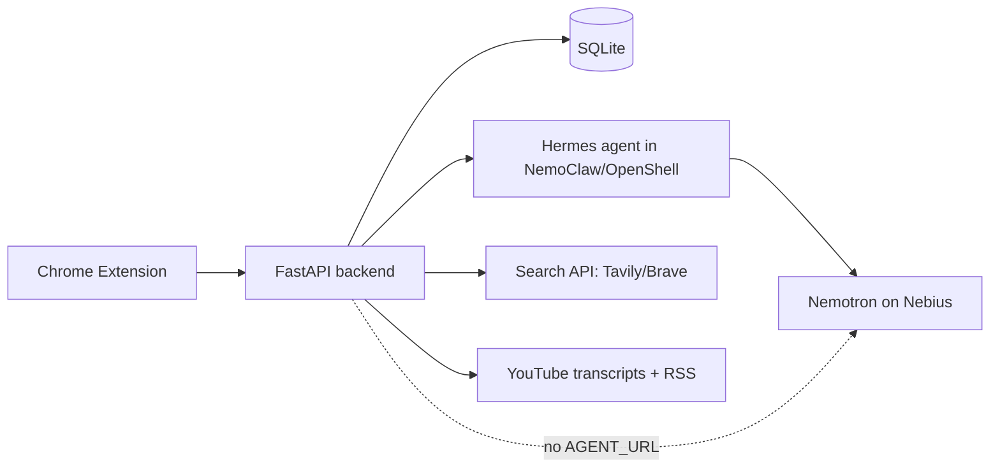

# TrustLens

**Ask your trusted YouTube creators. Every answer is cross-checked.**

  

Built for the **NVIDIA Personal AI Track** hackathon.

## Problem and Idea
Feeds make you scroll; they don't tell you what your trusted creators actually said, or whether it holds up. TrustLens lets you pick a few creators, ask a question ("What did X say about Y?"), and get the most relevant video moments (title, creator, timestamp link, short quote), ranked, each with an automatic **Legitimacy Report**.

## Demo
<!-- Add GIF / screenshots here: docs/demo.gif -->
*Demo GIF / screenshots: placeholder.*

1. **Add** creators and set a trust level (1-5).
2. **Ask** a question in the side panel.
3. **Read** ranked moments with verdict badges, evidence and red flags; jump straight to the timestamp.

## Features
- Side-panel Chrome extension (MV3, vanilla JS); background ingest every 6 hours.
- Semantic search over ~60s transcript chunks, LLM reranking to the top 5.
- **Legitimacy Report** per result:
  - `supported`: retrieved evidence agrees.
  - `mixed`: evidence is split.
  - `contradicted`: retrieved evidence disagrees (shown last, with a warning).
  - `insufficient`: not enough evidence to judge.
  - `Opinion/Unverifiable`: not a factual claim; no search performed.
- Red-flag chips: sponsorship/affiliate language, no cited source, absolute claims.
- Score breakdown, thumbs up/down feedback that nudges creator trust, weekly digest by topic.

## Personal AI Track fit
| Requirement | Where implemented |
|---|---|
| Always-on assistant | `extension/background.js` (`chrome.alarms`, 6h ingest) |
| Privacy / user-controlled data | Local SQLite only (`backend/db.py`); keys in `.env` |
| Persistent memory | `memory` table (questions, feedback), `creators.trust` weights (`db.py`, `/feedback`) |
| Reusable skills | `skills/*.md` |
| NVIDIA open model | Nemotron via OpenAI-compatible API on Nebius (`backend/llm.py`, `.env`) |
| Agent in sandbox | Hermes in NemoClaw/OpenShell at `AGENT_URL`, direct-LLM fallback (`llm.py`) |

## Architecture

Data flow:
1. The extension sends a question to `POST /ask`.
2. The backend embeds it and finds the top-20 chunks from trusted creators in SQLite.
3. The LLM (via Hermes if `AGENT_URL` is set) reranks to the top 5.
4. For each, the Legitimacy pipeline extracts the claim, gathers evidence (other creators + web), and judges.
5. Results are scored and sorted (contradicted last).
6. The panel renders cards; feedback goes to `POST /feedback` and updates memory and trust.

More detail: [docs/architecture.md](docs/architecture.md).

## Tech Stack
| Layer | Choice | Why |
|---|---|---|
| Extension | Chrome MV3, vanilla JS, side panel | No build step, small surface |
| Backend | Python, FastAPI | Simple, async-capable API |
| Storage | SQLite + cosine similarity (numpy) | Local, private, zero setup |
| LLM | Nemotron on Nebius (OpenAI-compatible) | Open NVIDIA model, swappable endpoint |
| Agent | Hermes in NemoClaw/OpenShell | Sandboxed, egress-restricted |
| Transcripts | youtube-transcript-api | No API key |
| Search | Tavily or Brave | Evidence from the open web |

## Legitimacy pipeline and scoring
`extract_claim` -> `gather_evidence` (top-5 chunks from *other* trusted creators + 3 web queries, top 5 results) -> `judge` (strict JSON) -> `red_flags`. Only retrieved sources can be cited; URLs the model invents are discarded; thin evidence yields `insufficient`; results are cached by claim hash.

```
score = 0.35*relevance + 0.2*trust/5 + 0.3*legitimacy + 0.1*consensus + 0.05*recency
legitimacy = {supported 1, mixed 0.5, insufficient 0.3, opinion 0.4, contradicted 0} x confidence
```
> **Honesty note:** this is evidence-based cross-checking of retrieved sources, **not a guarantee of truth**. Treat verdicts as a starting point.

## Privacy and Security
- All creators, transcripts, embeddings, memory and feedback are stored locally in SQLite.
- The agent runs in a NemoClaw/OpenShell sandbox with an egress allowlist: `youtube.com`, the LLM host, the search host.
- API keys live only in `.env` (git-ignored). No telemetry.
- Note: transcript text and claims are sent to your configured LLM and search providers.

## Setup
Prerequisites: Python 3.10+, Chrome, a Nebius API key, a Tavily or Brave key.
```bash
git clone <your-repo-url> trustlens && cd trustlens
python -m venv venv && source venv/bin/activate
pip install -r backend/requirements.txt
cp .env.example .env            # fill in keys and model names
cd backend && uvicorn main:app --port 8000
# Chrome: chrome://extensions -> Developer mode -> Load unpacked -> extension/
python scripts/seed.py          # from repo root, in a second terminal
```
Check the exact model IDs in your Nebius catalog and set `LLM_MODEL` / `EMBED_MODEL` accordingly.

## Optional: NemoClaw/Hermes sandbox
Set up Hermes inside an NVIDIA NemoClaw/OpenShell sandbox following the [NVIDIA NemoClaw docs](https://github.com/NVIDIA/NemoClaw), expose its OpenAI-compatible endpoint, allow egress to `youtube.com`, the LLM host and the search host only, then set `AGENT_URL` (and `AGENT_API_KEY`) in `.env`. If the agent call fails or `AGENT_URL` is empty, the backend calls the LLM directly.

## Usage walkthrough
1. Click the TrustLens icon; paste a channel URL, set trust, press **Add** (ingests latest videos).
2. Type a question, press **Ask**.
3. Read each card: verdict badge, confidence, red-flag chips; expand **Evidence**; click the timestamp link.
4. Press 👍 / 👎 to tune that creator's trust.

## Project structure
```
trustlens/
├─ CLAUDE.md, DEVELOPMENT.md, STATUS.md, README.md, LICENSE, .gitignore, .env.example
├─ extension/  manifest.json, sidepanel.html, sidepanel.js, background.js
├─ backend/    main.py, llm.py, ingest.py, ask.py, verify.py, db.py, requirements.txt
├─ skills/     ingest_creator.md, ask.md, verify_claim.md, weekly_digest.md
├─ docs/       architecture.md
└─ scripts/    seed.py
```

## Skills overview
- `ingest_creator`: add a creator and ingest transcripts.
- `ask`: retrieve, rerank, verify and rank moments.
- `verify_claim`: run the Legitimacy Report on a chunk.
- `weekly_digest`: new chunks this week grouped by topic.

## Project Tracking
- [CLAUDE.md](CLAUDE.md): project memory (goal, architecture, conventions, decisions).
- [DEVELOPMENT.md](DEVELOPMENT.md): changelog of what changed and why.
- [STATUS.md](STATUS.md): done vs remaining tasks.

Current progress: **see the first line of [STATUS.md](STATUS.md)** (1/7 done; 6 code-complete, awaiting live verification).

## Limitations and Roadmap
- Videos without captions are skipped; YouTube only.
- Verdict quality depends on retrieved evidence and the chosen model.
- Brute-force cosine search suits small libraries; swap in sqlite-vec for scale.
- Roadmap: more platforms, local models, test suite, evidence quality weighting.

## Contributing
Issues and PRs welcome; keep changes small and update `CLAUDE.md`, `DEVELOPMENT.md` and `STATUS.md`.

## License
MIT, see [LICENSE](LICENSE).

## Acknowledgements
NVIDIA NemoClaw, OpenShell, Hermes, and Nebius.
