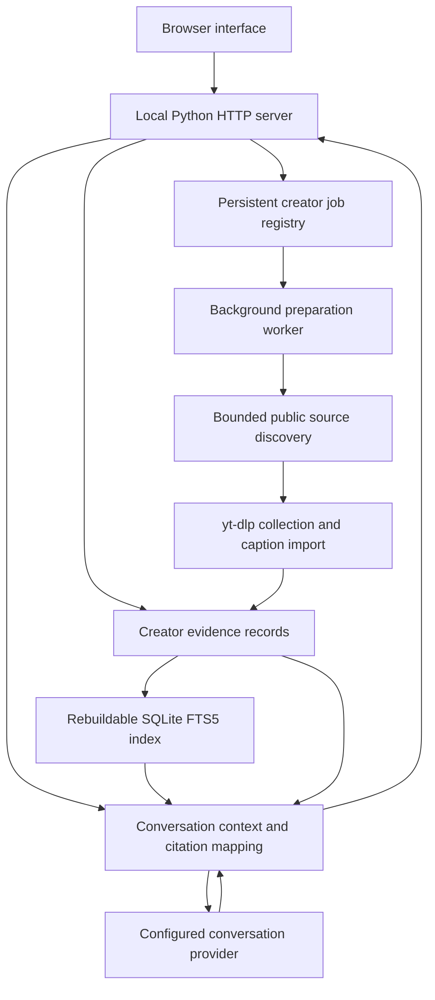

# Architecture

InstaNT is a local Python application with a browser interface. Its shared unit of reuse is a creator’s evidence library. A conversation remains separate from that library and never becomes source evidence merely because a model generated it.

## Request flow

The server binds to loopback. This prototype does not implement public hosting, user authentication, production tenancy, or cross-server job coordination.

## Evidence and storage

| Component | Role |
| --- | --- |
| Per-post JSON records | Authoritative creator identity, source URL, available publication date, processing status, media references, and evidence segments. |
| Caption segments | Text published with the post. They do not receive inferred video timestamps. |
| Speech segments | Optional automatically transcribed speech with measured start/end times and extraction provenance. |
| OCR segments | Optional sampled on-screen text with observation times. Sampling is incomplete by design. |
| Markdown notes | Readable derived exports, rebuilt from source records. No particular note-taking application is required. |
| SQLite FTS5 index | Derived keyword search scoped to the selected creator. It can be rebuilt from records. |
| Job registry | Persistent preparation state, progress details, coverage, request reuse, and explicit retries. |

Media remains local when available. The server checks that requested media resolves inside allowed source roots and supports byte ranges for playback. Bundled demo records contain no media, so a fresh installation offers caption evidence and original Instagram links without pretending to have a local video preview.

`bootstrap-demo` initializes an empty library from the packaged 11-caption seed and creates its derived notes and index. It preserves a library that already contains source records. Demo initialization does not contact Instagram or a model provider.

## Creator preparation and reuse

The registry normalizes a creator handle and ensures one active preparation job per creator. Requests for a ready creator reuse its stored coverage. Requests during preparation reuse the active job. A worker claims queued jobs, records progress, and marks the result ready only when searchable evidence exists.

Current preparation covers bounded discovery, collection, and caption indexing. Missing public links produce `needs_source_links`; collection failures and access restrictions remain visible. An explicitly saved `data/creators/<handle>/sources.json` can supply browser-observed links before a retry. There is no browser-cookie extraction, account rotation, or access-control bypass.

Unchanged valid media and extraction caches are reused. Full profile history, automatic speech/OCR preparation, incremental scheduling, and reliable archive completeness remain future work. A ready library means some usable evidence is indexed, not that every post has been collected or every modality processed.

## Conversation and citations

`POST /api/chat` accepts a question, one selected creator, and recent conversation history. The server bounds the history and evidence size. A small library can fit in the supplied context; larger collections require a bounded creator-scoped selection. Keyword retrieval is implemented; a semantic retrieval index is not.

The configured OpenAI-compatible conversation endpoint receives the question, recent conversation, and selected evidence. Configuration remains server-side. The example points to OpenRouter, but provider compatibility is separate from the evidence model.

Returned citation numbers must resolve to evidence supplied for the current reply. The server remaps valid citations to the source list returned with that reply. Invalid references are rejected. A correctly formatted citation does not prove that the passage supports the generated statement.

Source-cited replies are labeled `generated_unverified`. Uncited generated replies are labeled separately; greetings and clarification may need no evidence, while substantive creator claims still require review. A live smoke test exposed an uncited substantive follow-up, so uncited generation must not be presented as verified knowledge. Provider errors remain errors. The conversation endpoint does not silently replace a failed model reply with source excerpts.

The source search interface remains available when conversation is unconfigured. The separate `/api/ask` and CLI excerpt path is a retrieval utility, not the browser’s conversational substitute.

## API surface

| Route | Purpose |
| --- | --- |
| `GET /api/health` | App status and non-secret conversation configuration readiness. Configuration readiness does not prove the provider will accept the next request. |
| `GET /api/creators` | Indexed creators and actual per-modality coverage. |
| `POST /api/creators/request` | Normalize a creator request and reuse or queue preparation. |
| `GET /api/creators/status?handle=…` | Current persistent preparation state. |
| `POST /api/creators/retry` | Explicitly retry eligible preparation. |
| `GET /api/posts?creator=…` | Stored posts for the selected creator. |
| `GET /api/posts/<id>` | Complete source record and separated evidence. |
| `GET /api/search?q=…&creator=…` | Creator-scoped keyword source search. |
| `POST /api/chat` | Generated conversation with current-turn source references. |
| `GET /media/<id>` | Available local source media, subject to path restrictions. |

The vanilla HTML/CSS/JavaScript interface renders server text through safe text nodes, validates original Instagram link destinations, and supports keyboard interaction and narrow layouts. It loads no framework or external CDN.

## Credentials and deployment boundaries

Private chat settings belong in `.env.local` or server environment variables. The browser never receives the API key. Error handling redacts known secret values, and outbound generation does not forward credentials to redirects.

Recent chat context is held in the current browser session and passed with requests; account-based private chat persistence is not implemented. A future hosted service needs authentication, authorization, abuse controls, workload isolation, secret management, durable operations, and a privacy policy that describes provider transmission. The local prototype should not be exposed as a production multi-user service without that work.
